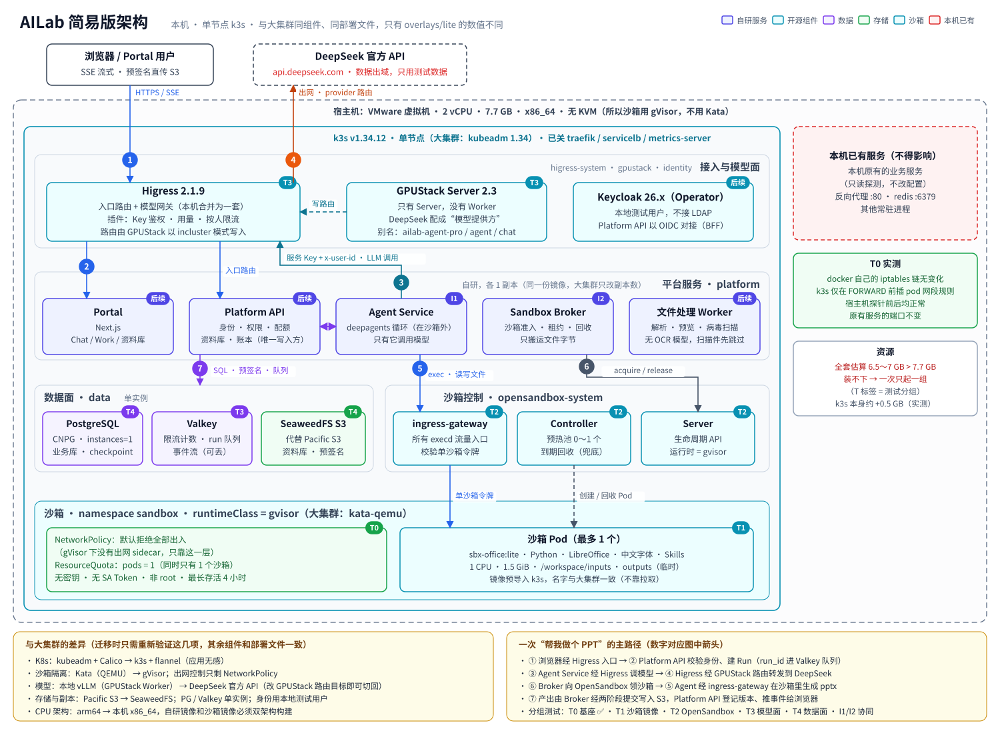

# AILab 简易版：分组件测试 + 协同测试

[](https://github.com/shijunan126-creator/ailab-lite/actions/workflows/ci.yml)

目标：在本机（2 vCPU / 7.7 GB，x86_64，无 KVM）上按组验证 AILab 的关键组件，**组件与大集群一致**，
只在 `deploy/overlays/lite` 里改数值。不跑完整平台，一次只起一组，测完拆掉。

## 快速开始：一键部署

在一台**已装好 Docker 和 k3s** 的 Linux 机器上（建议 ≥ 2 vCPU / 7 GB 内存，x86_64 或 arm64）：

```bash
git clone https://github.com/shijunan126-creator/ailab-lite && cd ailab-lite
sudo ./deploy.sh --model-key sk-xxxxxxxx     # 不带 --model-key 也行：先用"离线演示"模型体验完整链路
```

脚本会依次：检查前置条件 → 构建沙箱镜像（缺则构建，首次要几分钟）和平台镜像并导入 k3s →
启动 OpenSandbox → 生成随机令牌和 Secret → 发布模型目录 → 部署 5 个服务 → 构建并启动 Portal → 冒烟测试
（含经 Portal 登录代理的完整路径），最后打印 Portal 地址和登录令牌。可重复执行；`--dry-run` 只看不做。

```bash
./deploy.sh status          # 哪些在跑、模型列表
./deploy.sh --skip-build    # 只改配置/换 Key，不重新构建
./deploy.sh down            # 从 k3s 删除平台（会删数据，会先确认）
./deploy.sh --help
```

打开 http://127.0.0.1:3000，粘贴打印出来的令牌登录，在工作台选模型、提交任务（如"帮我做一个 PPT，介绍…"）。
Portal 默认只监听本机，从自己电脑看用 `ssh -L 3000:127.0.0.1:3000 <机器>`；`--listen 0.0.0.0` 会在网络上暴露
一个 HTTP 登录页，仅限可信网络。k3s 本身的安装见 `tests/t0_base.sh`，平台的详细说明见 [platform/README.md](platform/README.md)。

> 模型怎么接、Key 放哪、以后怎么换成本地模型：见 platform/README.md 的"模型目录"。用户在界面上选模型，不接触 Key。

## 架构图



源码 `diagrams/src/d_lite_arch.py`（沿用 AILab 文档的绘图库），重新生成：`cd diagrams/src && python3 -I d_lite_arch.py && python3 -I render.py`。

## 测试分组

| 组 | 组件 | 关键验收 | 依赖 | 状态 |
|---|---|---|---|---|
| T0 基座 | k3s v1.34.12 + gVisor RuntimeClass + sandbox 命名空间 | gVisor Pod 可运行；**装前装后宿主机探针正常** | — | ✅ 10-20 通过 |
| T1 沙箱镜像 | `sbx-office:lite` | runc / gVisor 下冒烟通过；网络全不通；配额只许 1 个；记录内存峰值 | T0 | ✅ runc + gVisor 通过（峰值 177 / 182 MiB） |
| T1b 双架构 | buildx amd64+arm64 | arm64 镜像能在 QEMU 下跑通冒烟 | T1 | 待准备 |
| T2 沙箱面 | OpenSandbox server + controller + ingress-gateway（gvisor） | 预热池领取、exec、文件进出、Secure Access 拦截无令牌请求、到期回收 | T0、T1 | dev server 跑通（Docker runtime）；k8s 控制面待准备 |
| T3 模型面 | GPUStack Server（无 Worker）+ Higress 2.1.9 + Valkey + DeepSeek 提供方 | 别名路由、服务 Key 鉴权、流式 usage、**限流真的拒绝**、x-user-id 透传 | T0、**DeepSeek 密钥** | 待准备 |
| T4 数据面 | CNPG + SeaweedFS | 预签名上传下载、版本管理、PG 备份到 S3 | T0 | 待准备 |

| 协同 | 组合 | 验证什么 |
|---|---|---|
| I1 | T2 + T3 + 最小 Agent（deepagents + OpenSandbox 后端） | "帮我做一个 ppt"：Agent 在沙箱外经 Higress 调 DeepSeek，在 gVisor 沙箱里生成 pptx |
| I2 | I1 + T4 + 最小 Broker | 文件从 S3 注入 `/workspace/inputs`，产出两阶段提交回 S3 |

## 平台服务（自研）

`platform/` 已实现架构图里的 Portal、Platform API、Agent Service、Sandbox Broker、文件处理 Worker，
并用 dev 适配器跑通“帮我做 PPT”端到端：SQLite 代替 CNPG、本机 Redis 代替 Valkey、本地目录代替
SeaweedFS、OpenSandbox dev server（Docker runtime）或 Docker CLI 代替 k8s/gVisor 沙箱、
模型目录（DeepSeek 官方 API / mock）暂代 Higress/GPUStack，用户在界面选模型。平台服务已通过 `platform/deploy/k8s/platform.yaml` 跑在现有 k3s
（`platform` 命名空间，API NodePort 30080）。T3/T4 就绪后只改 `.env` 和对应 adapter。详见
[platform/README.md](platform/README.md)。

## 本机约束

- **宿主机保护**：测试脚本会装 k3s、改容器运行时，在还跑着别的重要服务的机器上要小心。`tests/lib.sh` 提供两个钩子
  `guard_busy_window`（忙时拒绝动宿主机，`FORCE=1` 可强制）和 `host_probe`（改动前后各探测一次本机关键服务），
  默认都不拦截；机器特有的规则写在不入库的 `tests/local.sh`（样例 `tests/local.sh.example`）。
- **不碰 docker 配置**：gVisor 只注册到 k3s 自己的 containerd；runsc 的 deb 安装脚本在 `/etc/docker/daemon.json` 存在时会改它并 reload docker，安装前检查。
- 内存：一次只起一组；T3 / T4 不同时运行。

## 回滚

```bash
/usr/local/bin/k3s-uninstall.sh   # 删除 k3s 及其 iptables 规则
dpkg -r runsc
```

## 目录

- `k3s/`：k3s 配置、runsc 的 containerd 片段
- `images/sbx-office/`：沙箱镜像、pptx-builder Skill、冒烟脚本
- `deploy/base`、`deploy/overlays/lite`：部署文件（大集群对应 `overlays/prod`）
- `platform/`：自研平台服务（Portal / Platform API / Agent / Broker / Worker）与 dev 启动脚本
- `tests/`：各组测试脚本；`logs/`：本机测试输出与 iptables 快照（只在本机，不入库）
